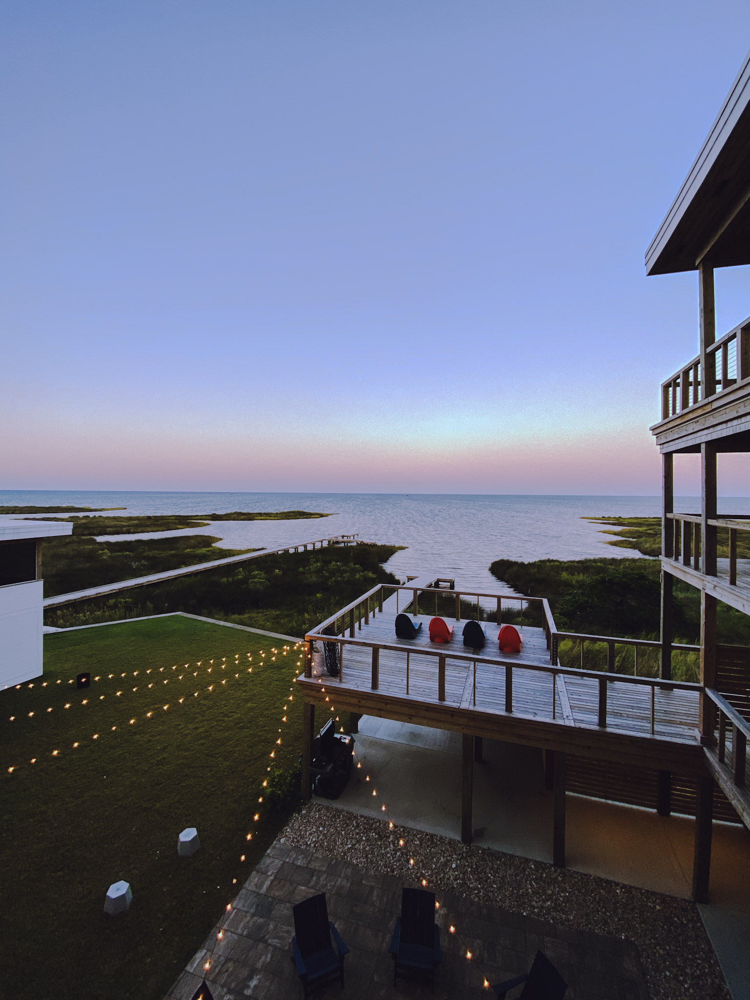

# SEO Analysis Report for mrae19.github.io

**Date:** Generated Analysis  
**Domain:** mattrae.ca (via CNAME)  
**Main Page:** index.html

---

## ✅ STRENGTHS

### 1. **Basic HTML Structure**
- ✅ Proper DOCTYPE declaration
- ✅ Language attribute set (`lang="en-US"`)
- ✅ Character encoding declared (`utf-8`)
- ✅ Viewport meta tag for mobile responsiveness
- ✅ Semantic HTML5 elements used (header, footer, nav, main, section)

### 2. **Title Tag**
- ✅ Present and descriptive: "Matt Rae | Community Advocate at Adobe - Photographer, Designer, Explorer of the Outdoors."
- ✅ Good length (under 60 characters)
- ✅ Includes key terms and branding

### 3. **Analytics**
- ✅ Google Analytics implemented (UA-159754778-1)

### 4. **Performance Optimizations**
- ✅ DNS prefetch for external resources (fonts.googleapis.com, s.w.org)
- ✅ Async loading for Google Analytics

### 5. **Content Structure**
- ✅ Clear heading hierarchy (H1, H3)
- ✅ Descriptive content about services and expertise
- ✅ Good use of semantic sections

---

## ❌ CRITICAL ISSUES TO FIX

### 1. **Missing Meta Description** ⚠️ HIGH PRIORITY
**Issue:** No meta description tag found  
**Impact:** Search engines may generate their own description, which may not be optimal  
**Fix:** Add a compelling 150-160 character meta description

```html
<meta name="description" content="Matt Rae is a Community Advocate at Adobe, photographer, and designer based in Kingston, ON. Expert in Photoshop, Lightroom, and Adobe XD workflows.">
```

### 2. **Missing Open Graph Tags** ⚠️ HIGH PRIORITY
**Issue:** No Open Graph meta tags for social media sharing  
**Impact:** Poor social media preview cards when shared on Facebook, LinkedIn, etc.  
**Fix:** Add Open Graph tags:

```html
<meta property="og:title" content="Matt Rae | Community Advocate at Adobe - Photographer, Designer">
<meta property="og:description" content="Community Advocate at Adobe focused on Photoshop and Lightroom. Designer, photographer & community ambassador based in Kingston, ON, Canada.">
<meta property="og:image" content="https://mattrae.ca/images/matt-hero@2x.png">
<meta property="og:url" content="https://mattrae.ca">
<meta property="og:type" content="website">
<meta property="og:site_name" content="Matt Rae">
```

### 3. **Missing Twitter Card Tags** ⚠️ HIGH PRIORITY
**Issue:** No Twitter Card meta tags  
**Impact:** Poor Twitter sharing experience  
**Fix:** Add Twitter Card tags:

```html
<meta name="twitter:card" content="summary_large_image">
<meta name="twitter:title" content="Matt Rae | Community Advocate at Adobe">
<meta name="twitter:description" content="Community Advocate at Adobe focused on Photoshop and Lightroom. Designer, photographer & community ambassador.">
<meta name="twitter:image" content="https://mattrae.ca/images/matt-hero@2x.png">
<meta name="twitter:site" content="@mattraeca">
```

### 4. **Missing Image Alt Text** ⚠️ HIGH PRIORITY
**Issue:** Multiple images have empty `alt=""` attributes  
**Impact:** Poor accessibility and missed SEO opportunities  
**Affected Images:**
- Line 44: Logo image
- Line 96: Hero profile image
- Lines 121, 127, 133, 139, 150, 156, 162, 168: Photography gallery images
- Lines 198, 209, 220, 229: Article card images
- Lines 259, 270, 281, 292: Talk/event images
- Lines 354, 359, 364, 369, 377, 382, 387, 392: Company logo images
- Line 432: Footer logo

**Fix:** Add descriptive alt text for all images. Examples:
```html



```

### 5. **Missing Structured Data (JSON-LD)** ⚠️ MEDIUM PRIORITY
**Issue:** No structured data markup  
**Impact:** Search engines can't understand your content type (Person, Professional, etc.)  
**Fix:** Add JSON-LD structured data:

```html
<script type="application/ld+json">
{
  "@context": "https://schema.org",
  "@type": "Person",
  "name": "Matt Rae",
  "jobTitle": "Community Advocate",
  "worksFor": {
    "@type": "Organization",
    "name": "Adobe"
  },
  "url": "https://mattrae.ca",
  "sameAs": [
    "https://twitter.com/mattraeca",
    "https://www.linkedin.com/in/mattrae/"
  ],
  "email": "matt@mattrae.ca",
  "address": {
    "@type": "PostalAddress",
    "addressLocality": "Kingston",
    "addressRegion": "ON",
    "addressCountry": "CA"
  },
  "knowsAbout": ["Photography", "Design", "Adobe Photoshop", "Adobe Lightroom", "Adobe XD"]
}
</script>
```

### 6. **Missing Canonical URL** ⚠️ MEDIUM PRIORITY
**Issue:** No canonical tag  
**Impact:** Potential duplicate content issues if site is accessible via multiple URLs  
**Fix:** Add canonical tag:

```html
<link rel="canonical" href="https://mattrae.ca/">
```

### 7. **Missing Robots.txt** ⚠️ MEDIUM PRIORITY
**Issue:** No robots.txt file  
**Impact:** Search engines may not crawl efficiently  
**Fix:** Create robots.txt:

```
User-agent: *
Allow: /
Sitemap: https://mattrae.ca/sitemap.xml
```

### 8. **Missing XML Sitemap** ⚠️ MEDIUM PRIORITY
**Issue:** No sitemap.xml file  
**Impact:** Search engines may not discover all pages efficiently  
**Fix:** Create sitemap.xml with all important pages

### 9. **Missing Favicon in Multiple Formats** ⚠️ LOW PRIORITY
**Issue:** Only PNG favicon, missing other formats  
**Impact:** May not display optimally across all devices  
**Fix:** Add multiple favicon formats and apple-touch-icon

```html
<link rel="icon" type="image/png" sizes="32x32" href="images/favicon2.png">
<link rel="icon" type="image/png" sizes="16x16" href="images/favicon2.png">
<link rel="apple-touch-icon" href="images/favicon2.png">
```

---

## ⚠️ MEDIUM PRIORITY IMPROVEMENTS

### 10. **Heading Structure**
**Current:** H1 → H3 (skipping H2)  
**Recommendation:** Use proper hierarchy: H1 → H2 → H3  
**Fix:** Change section headings from H3 to H2 where appropriate

### 11. **Internal Linking**
**Issue:** Limited internal linking structure  
**Recommendation:** Add more internal links between related content sections

### 12. **External Links**
**Issue:** External links open in new tabs (good) but no `rel="noopener noreferrer"`  
**Fix:** Add security attributes:

```html
<a href="https://adobe.ly/3fQo2w7" target="_blank" rel="noopener noreferrer">
```

### 13. **Content Keywords**
**Recommendation:** Ensure natural keyword usage for:
- "Adobe Photoshop"
- "Adobe Lightroom"
- "Adobe XD"
- "Photography"
- "Design"
- "Community Advocate"

### 14. **Page Speed Considerations**
- ✅ External fonts loaded (could be optimized further)
- ⚠️ Multiple external scripts
- ⚠️ Consider lazy loading for images below the fold

---

## 📊 SEO SCORE BREAKDOWN

| Category | Score | Status |
|----------|-------|--------|
| **On-Page SEO** | 6/10 | ⚠️ Needs Improvement |
| **Technical SEO** | 7/10 | ✅ Good |
| **Content Quality** | 8/10 | ✅ Good |
| **Mobile Optimization** | 9/10 | ✅ Excellent |
| **Social Media** | 2/10 | ❌ Critical |
| **Accessibility** | 4/10 | ⚠️ Needs Improvement |
| **Structured Data** | 0/10 | ❌ Missing |
| **Overall Score** | **5.1/10** | ⚠️ Needs Work |

---

## 🎯 PRIORITY ACTION ITEMS

### Immediate (Do First):
1. ✅ Add meta description
2. ✅ Add Open Graph tags
3. ✅ Add Twitter Card tags
4. ✅ Add alt text to all images
5. ✅ Add canonical URL

### Short-term (This Week):
6. ✅ Add JSON-LD structured data
7. ✅ Create robots.txt
8. ✅ Create sitemap.xml
9. ✅ Fix heading hierarchy (H2 instead of H3)

### Long-term (This Month):
10. ✅ Add rel="noopener noreferrer" to external links
11. ✅ Optimize image loading (lazy load)
12. ✅ Add more internal linking
13. ✅ Consider adding a blog/content section for SEO

---

## 📝 ADDITIONAL RECOMMENDATIONS

1. **Content Expansion:** Consider adding a blog or articles section to improve SEO through fresh content
2. **Local SEO:** Since you're based in Kingston, ON, consider adding local business schema
3. **Performance:** Consider implementing lazy loading for images below the fold
4. **Security:** Add `rel="noopener noreferrer"` to all external links
5. **Analytics:** Consider upgrading to Google Analytics 4 (GA4) as Universal Analytics is being sunset

---

## 🔍 KEYWORDS TO TARGET

Based on your content, focus on:
- Adobe Community Advocate
- Adobe Photoshop expert
- Adobe Lightroom workflows
- Photography tutorials
- Adobe XD design
- Designer Kingston Ontario
- Product design consultant

---

**Next Steps:** I can help implement these fixes. Would you like me to:
1. Update the index.html file with all the missing meta tags?
2. Create robots.txt and sitemap.xml files?
3. Add alt text to all images?
4. Add structured data markup?
