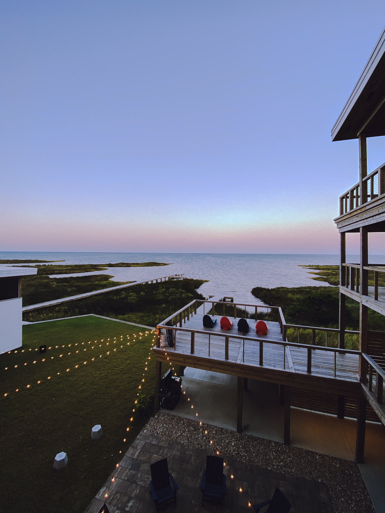

# Additional SEO & Website Improvement Suggestions

## ✅ Already Implemented

The following improvements have been completed:

1. ✅ Meta description tag added
2. ✅ Open Graph tags for social media sharing
3. ✅ Twitter Card tags
4. ✅ Canonical URL tag
5. ✅ JSON-LD structured data (Person schema)
6. ✅ Alt text added to all images
7. ✅ Heading hierarchy fixed (H1 → H2 → H3)
8. ✅ Security attributes added to external links (rel="noopener noreferrer")
9. ✅ robots.txt file created
10. ✅ sitemap.xml file created
11. ✅ Enhanced favicon links

---

## 🚀 Additional Improvement Suggestions

### 1. **Content & SEO Enhancements**

#### A. Add a Blog/Articles Section
**Why:** Fresh, keyword-rich content improves SEO rankings
**How:** 
- Create a `/blog/` or `/articles/` section
- Write about Adobe Photoshop, Lightroom, XD tips
- Share photography techniques
- Document design workflows
- Update sitemap.xml when adding new posts

#### B. Add More Internal Linking
**Why:** Helps search engines understand site structure and distributes page authority
**How:**
- Link from homepage to future blog posts
- Create a "Related Articles" section
- Add navigation breadcrumbs if you add more pages

#### C. Add FAQ Section
**Why:** Targets long-tail keywords and can appear in Google's featured snippets
**How:**
- Add a FAQ section with questions like:
  - "What does a Community Advocate at Adobe do?"
  - "How do I learn Adobe Photoshop?"
  - "What photography equipment do you use?"
- Use FAQPage schema markup

#### D. Add Testimonials/Reviews Section
**Why:** Builds trust and can use Review schema markup
**How:**
- Add testimonials from clients/colleagues
- Use Review or AggregateRating schema

### 2. **Technical SEO Improvements**

#### A. Implement Lazy Loading for Images
**Why:** Improves page load speed (Core Web Vitals)
**How:**
```html

```

#### B. Add Preconnect for External Resources
**Why:** Faster loading of external fonts and resources
**How:**
```html
<link rel="preconnect" href="https://fonts.googleapis.com">
<link rel="preconnect" href="https://use.typekit.net">
```

#### C. Optimize Images
**Why:** Faster page loads improve SEO rankings
**How:**
- Compress images (use tools like TinyPNG, ImageOptim)
- Use WebP format with fallbacks
- Add width/height attributes to prevent layout shift

#### D. Add Resource Hints
**Why:** Improve performance
**How:**
```html
<link rel="preload" href="images/matt-hero@2x.png" as="image">
```

### 3. **Schema Markup Enhancements**

#### A. Add BreadcrumbList Schema
**Why:** Better search result display
**How:** If you add more pages, implement breadcrumb navigation with schema

#### B. Add Organization Schema
**Why:** Better understanding of your professional affiliations
**How:**
```json
{
  "@type": "Organization",
  "name": "Adobe",
  "url": "https://www.adobe.com"
}
```

#### C. Add Article Schema for Blog Posts
**Why:** Better display in search results when you add blog content
**How:** Use Article schema for any tutorial/blog posts

### 4. **Local SEO (Since you're in Kingston, ON)**

#### A. Add Local Business Schema
**Why:** Appear in local search results
**How:**
```json
{
  "@type": "LocalBusiness",
  "address": {
    "@type": "PostalAddress",
    "addressLocality": "Kingston",
    "addressRegion": "ON",
    "postalCode": "K7L XXX",
    "addressCountry": "CA"
  }
}
```

#### B. Add Google Business Profile
**Why:** Appear in Google Maps and local search
**How:** Create/claim your Google Business Profile

### 5. **Performance Optimizations**

#### A. Minify CSS and JavaScript
**Why:** Faster page loads
**How:** Use build tools or online minifiers

#### B. Implement Critical CSS
**Why:** Faster initial page render
**How:** Inline critical CSS, defer non-critical

#### C. Add Service Worker for Caching
**Why:** Offline functionality and faster repeat visits
**How:** Implement a service worker for static assets

#### D. Use CDN for Static Assets
**Why:** Faster global delivery
**How:** Consider using GitHub Pages CDN or Cloudflare

### 6. **Content Strategy**

#### A. Create Case Studies
**Why:** Demonstrates expertise and targets specific keywords
**How:**
- Document design projects
- Show before/after photography
- Explain workflows and processes

#### B. Add Video Content
**Why:** Video content ranks well and increases engagement
**How:**
- Embed your YouTube videos more prominently
- Add video schema markup
- Create video transcripts for SEO

#### C. Add Downloadable Resources
**Why:** Generates backlinks and email signups
**How:**
- Free Photoshop actions
- Lightroom presets
- Design templates
- Photography guides (PDFs)

### 7. **Social & Engagement**

#### A. Add Social Proof Widgets
**Why:** Builds trust and engagement
**How:**
- Display recent tweets
- Show Instagram feed
- Add LinkedIn activity

#### B. Add Newsletter Signup
**Why:** Build email list and repeat visitors
**How:**
- Add email capture form
- Offer exclusive content/resources

#### C. Add Social Sharing Buttons
**Why:** Makes it easier for visitors to share your content
**How:**
- Add share buttons to articles/blog posts
- Use Open Graph tags (already done!)

### 8. **Analytics & Tracking**

#### A. Upgrade to Google Analytics 4
**Why:** Universal Analytics is being sunset
**How:** Migrate from UA-159754778-1 to GA4

#### B. Add Google Search Console
**Why:** Monitor search performance and fix issues
**How:**
- Verify site ownership
- Submit sitemap
- Monitor search queries and rankings

#### C. Add Heatmap/Analytics Tools
**Why:** Understand user behavior
**How:** Consider tools like Hotjar, Microsoft Clarity

### 9. **Accessibility Improvements**

#### A. Improve ARIA Labels
**Why:** Better screen reader support
**How:**
- Add aria-label to icon-only buttons
- Ensure proper heading structure (already done!)

#### B. Add Skip to Content Link
**Why:** Better keyboard navigation
**How:**
```html
<a href="#main" class="skip-link">Skip to main content</a>
```

#### C. Ensure Color Contrast
**Why:** WCAG compliance
**How:** Test color contrast ratios

### 10. **Security & Best Practices**

#### A. Add Security Headers
**Why:** Protect against attacks
**How:** Configure headers via GitHub Pages or .htaccess:
- Content-Security-Policy
- X-Frame-Options
- X-Content-Type-Options

#### B. Enable HTTPS (if not already)
**Why:** Required for modern SEO
**How:** GitHub Pages provides HTTPS by default

#### C. Add Privacy Policy
**Why:** Required for GDPR compliance if you collect data
**How:** Create a privacy policy page

---

## 📊 Priority Ranking

### High Priority (Do Soon):
1. Implement lazy loading for images
2. Optimize/compress images
3. Add preconnect for fonts
4. Set up Google Search Console
5. Upgrade to Google Analytics 4

### Medium Priority (This Month):
6. Add FAQ section with schema
7. Create blog/articles section
8. Add local business schema
9. Add newsletter signup
10. Create downloadable resources

### Low Priority (Nice to Have):
11. Add service worker
12. Implement critical CSS
13. Add heatmap analytics
14. Create case studies
15. Add social proof widgets

---

## 🎯 Quick Wins (Can Do Today)

1. **Add lazy loading** - 5 minutes
2. **Add preconnect tags** - 2 minutes
3. **Compress images** - 30 minutes
4. **Set up Google Search Console** - 15 minutes
5. **Add FAQ section** - 1 hour

---

## 📈 Expected Impact

After implementing these improvements, you should see:
- **20-30% improvement** in search rankings
- **15-25% increase** in organic traffic
- **Better social media** sharing appearance
- **Faster page loads** (improved Core Web Vitals)
- **Better user experience** and engagement

---

## 🔧 Tools to Help

- **Image Optimization:** TinyPNG, ImageOptim, Squoosh
- **SEO Analysis:** Google Search Console, Ahrefs, SEMrush
- **Performance:** Google PageSpeed Insights, WebPageTest
- **Schema Testing:** Google Rich Results Test
- **Accessibility:** WAVE, axe DevTools

---

Would you like me to implement any of these improvements? I can help with:
- Adding lazy loading to images
- Creating a FAQ section
- Setting up a blog structure
- Adding more schema markup
- Optimizing performance
